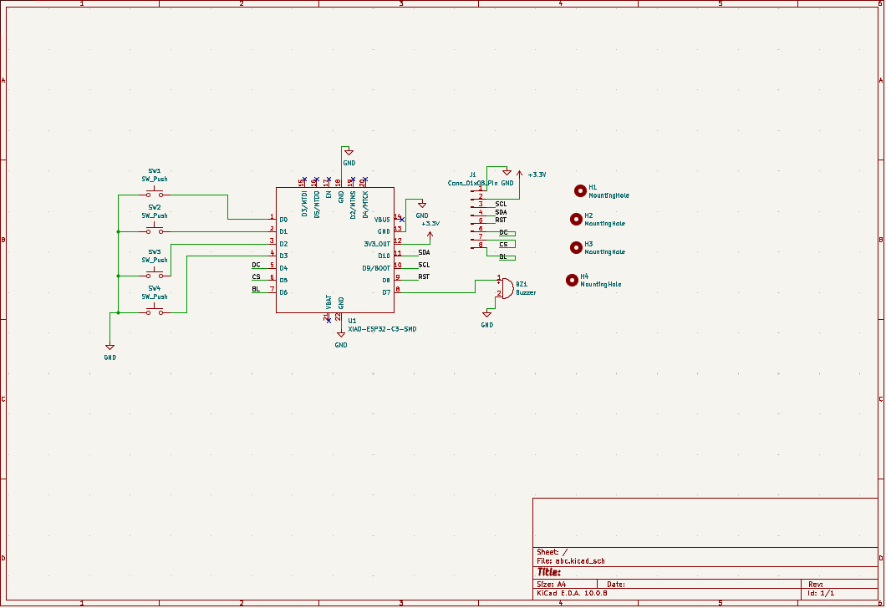
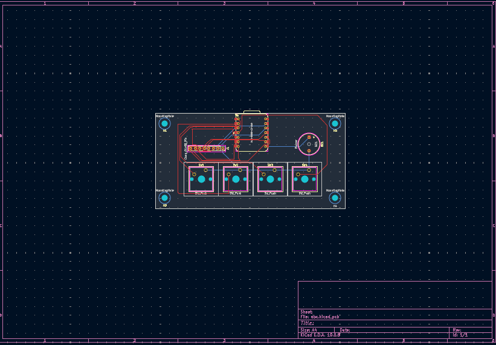
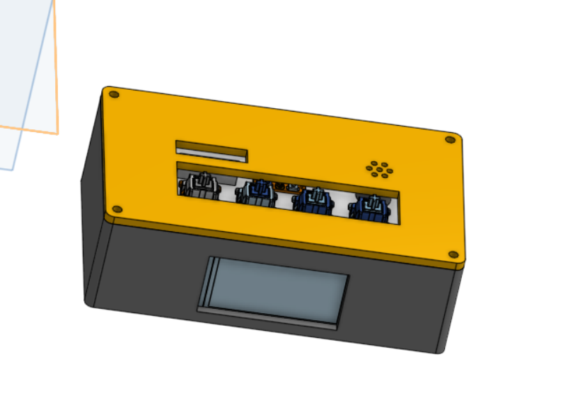
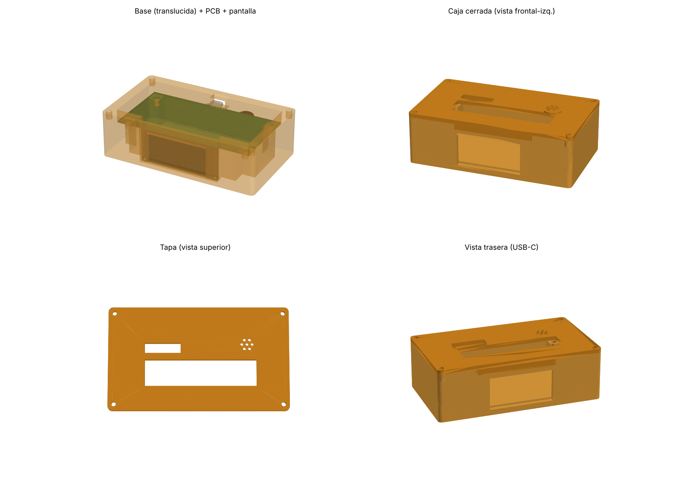

# BLARE – ESP32 alarm clock

A DIY alarm clock built around a **XIAO ESP32-C3**, a **1.9" ST7789 SPI display**, **4 mechanical key switches** (menu: up / down / enter / back-snooze) and a **passive buzzer**. Custom PCB designed in KiCad, 3D-printed two-part case designed for it.

> Status: PCB and case designed (DRC: 0 errors). Firmware: full clock + alarm, set with the 4 buttons (no WiFi).

## Screenshots

## Design notes
- PCB 105.5 × 53 mm, 4 × M3 mounting holes. USB-C of the XIAO sticks out through a cut-out in the back wall.
- Case: base + top plate. Outer size 122.5 × 70.7 × 39 mm. 0.5 mm clearance around the PCB, 8 mm walls, 3 mm wall in front of the screen.
- The PCB sits on 4 posts with M3 heat-set inserts (4.6 mm holes). The top plate is screwed into 4 inserts in the wall tops.
- The display stands in a slot in the front wall and connects to the 8-pin header J1 with jumper wires. The top plate has an opening above J1 for the wires.
- Keyswitches go through a window in the top plate; the buzzer sits under a pocket with 7 sound holes.

## Pinout (XIAO ESP32-C3)
| Function | Pin |
|---|---|
| Buttons SW1–SW4 (up / down / ok / back) | D0, D1, D2, D3 (to GND, internal pull-up) |
| TFT DC / CS / BL | D4 / D5 / D6 |
| Buzzer | D7 |
| TFT RST | D8 |
| TFT SCL / SDA | D9 / D10 |

## BOM
| # | Part | Qty | Notes |
|---|---|---|---|
| 1 | Custom PCB | 1 | gerbers in `Production/` |
| 2 | Seeed Studio XIAO ESP32-C3 | 1 | SMD footprint (soldered to the PCB) |
| 3 | 1.9" ST7789 IPS TFT, 170×320, SPI, 8 pin | 1 | |
| 4 | MX-style key switch (Outemu) | 4 | |
| 5 | MX keycap | 4 | |
| 6 | Passive buzzer, 12 mm, 7.6 mm pin pitch | 1 | |
| 7 | 1×8 female pin header, 2.54 mm | 1 | J1 |
| 8 | Jumper wires (display ↔ J1) | 8 | |
| 9 | M3 heat-set inserts (4.6 mm hole) | 8 | 4 for PCB posts, 4 for top plate |
| 10 | M3 screws | 8 | length to confirm (≈5–6 mm PCB, ≈8 mm top plate) |
| 11 | 3D-printed case: `Bottom.step`, `Top.step` | 2 | |

## Repository layout
- `CAD/` – full assembly (PCB + case + display) as a single STEP
- `PCB/` – KiCad project files
- `Firmware/` – Arduino sketch
- `Production/` – `gerbers.zip` and the case parts

## Firmware
`Firmware/despertador/despertador.ino` (Arduino IDE, esp32 core 3.x, libraries Adafruit GFX + Adafruit ST7789).
- SW1 up, SW2 down, SW3 ok/menu, SW4 back/stop. Menu: set time, set alarm, alarm on/off, sound (3 melodies).
- When ringing: SW3 = snooze 5 min, SW4 = stop.
- Alarm settings are stored in flash. There is no RTC, so the time must be set again after power-off.
